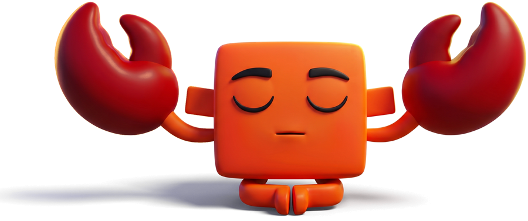

<div align="center">



# CLAW

### It asks before it guesses. It proves before it claims.

**A working method for Claude Code: one set of rules and a team of agents, installed in your project in one command.**

[](https://github.com/290990-collab/CLAW/actions/workflows/tests.yml)


[](LICENSE)

<table>
<tr>
<td align="center" width="33%"><h3>22,000 lines</h3>a billing service and its tests, built from one request<br><sub><a href="#proof">948 tests green, 2 h</a></sub></td>
<td align="center" width="33%"><h3>16 of 16</h3>bug tickets fixed in one prompt<br><sub><a href="#proof">checked by hidden tests</a></sub></td>
<td align="center" width="33%"><h3>91%</h3>of the build's tokens went to cheaper agents<br><sub><a href="#proof">Opus plans, Sonnet writes</a></sub></td>
</tr>
</table>

[Why](#why) · [Before / after](#before--after) · [Install](#getting-started) · [Proof](#proof) · [Everyday use](#everyday-use) · [Commands](#commands) · [Agents](#agents) · [FAQ](#faq)

</div>

<br>

## Why

Claude Code is brilliant on a small task and drifts on a big one. It guesses what an
unclear request meant, says "done" on what it never ran, rewrites a failing test until it
passes, and spends Opus tokens reading files a cheaper model could read.

Claude Code gives you agents, hooks and skills, but no method. CLAW adds one: the same
rules and the same team of agents in every project, kept up to date from one source.
Built for long tasks and large repos, where those habits cost the most.

> [!NOTE]
> CLAW does not run on its own. It installs files into your project (`CLAUDE.md`,
> `.claude/agents/`, `.claude/shared/`, hooks, state files) that Claude Code reads
> in every session.

<br>

## Before / after

| You say | Claude Code alone, often | With CLAW |
|---|---|---|
| "Add an export" | Picks a format and builds it | Asks the one question that changes the work: CSV or JSON, and for whom |
| "Fix the failing test" | Edits the expected value until it is green | Fixes the cause. If the test is what is wrong, it says so and fixes it in its own change |
| "Add a date field" | Writes a date picker by hand | Checks the repo, then the platform: reuses your input with `type="date"` |
| "Is it done?" | "Done!" | "Done. Not verified: the migration was not run on a real database" |
| A long task | One expensive model does everything | Opus plans and checks; cheaper agents read, run and write |
| "Commit and push it" | Commits and pushes | Shows what will change and waits for your ok |

<sub>Illustrative. Each row is a rule in the installed <code>CLAUDE.md</code>, not a recorded transcript.</sub>

<br>

## What's inside

| | What it means for you |
|---|---|
| **Evidence first** | Claude cites only what it read or ran, says what it did not check, finds the cause before fixing, and asks when a request is unclear |
| **Small, safe changes** | No unrequested refactoring, tests never weakened to go green. Commits, installs and anything irreversible wait for your ok |
| **A team sized to the task** | The coordinator knows it can delegate and decides each time on cost and effectiveness: cheaper agents read, run and execute, the top model judges. Small changes it does itself |
| **State across sessions** | `docs/TODO.md`, `docs/status.md` and `docs/roadmap.md` say where the work is; every session starts from them |
| **Safety hooks** | Claude cannot skip your git hooks or relax a linter configuration. An optional hook makes it check who uses a file before its first edit |
| **One source, many projects** | Update CLAW once, then bring each project up to date. What you adapted stays |

<br>

## Getting started

### Prerequisites

| You need | Why |
|---|---|
| [Claude Code](https://code.claude.com) | CLAW is a method for it |
| Python 3.11 or later | The `claw` tool and the hooks. Standard library only, nothing to install |
| git | `claw update` and `claw status` |

### Install

Once per machine:

```bash
# macOS · Linux
git clone https://github.com/290990-collab/CLAW.git ~/.claude/CLAW
python ~/.claude/CLAW/CLAW/claw.py setup
```

```powershell
# Windows · PowerShell
git clone https://github.com/290990-collab/CLAW.git $HOME\.claude\CLAW
python $HOME\.claude\CLAW\CLAW\claw.py setup
```

`setup` shows what it writes and asks for your ok. It adds the `/claw` and
`/delegate` skills to Claude Code and the `claw` command to `~/.local/bin`.

> [!TIP]
> If `~/.local/bin` is not on your PATH, `setup` tells you. Add it and open a new
> terminal.

Then, in each project, open Claude Code in the project folder and run:

```text
/claw install
```

It asks five questions, shows every file it will write and waits for your ok.

<br>

## Proof

Measured with `claude -p` on Claude Code 2.1.294 to 2.1.301, Opus 5.5 as coordinator. Nothing rounded up, and the row that loses stays.

| Task | Result | Cost |
|---|---|---|
| **Build** `tally`, a B2B billing service, from one request | 10,846 lines of code, 11,390 lines of tests, 948 tests green, in 2 h 01 min. 7 `implementer` agents on Sonnet 5.5; 91% of the tokens were theirs, 9% Opus | 85% of one Pro session, read in the app |
| **Fix** 16 seeded bugs in `tally`, given as 16 tickets in one prompt | 16 of 16 fixed in both runs, checked by hidden tests | $3.89 and $5.95 |
| **Small tasks**: one bug fix, one medium feature | Both solved, with and without CLAW | **CLAW costs more**: +31% and +15% to +96% |

What this does not show yet: a run of the 16 tickets *without* CLAW, so no saving is
claimed. On small tasks the method is overhead, and CLAW accepts it: it is tuned for
the long tasks where an unchecked guess costs hours. The test repositories are built
for the eval and are smaller than most production code.

<br>

## Everyday use

| I want to… | Do this |
|---|---|
| Set up a project | In Claude Code, in the project: `/claw install` |
| Get a new CLAW release | In a terminal: `claw update`. It lists what arrives and asks before merging |
| Bring a project to the new release | In Claude Code, in that project: `/claw update`. Your adaptations stay |
| See if a project is behind | In a terminal, in the project folder: `claw status` |
| Check that a project is healthy | `claw doctor`, or `/claw fix` to also repair it |
| Stop and resume later | Say `safe pause`. Claude writes where things are in `docs/TODO.md` |

> [!IMPORTANT]
> `claw update` touches only CLAW itself. A project changes only when you run
> `/claw update` inside it, so nothing moves in a project you are not looking at.

> [!WARNING]
> **From 2.2 to 2.5:** the manifest is now `.claude/claw.json`. In each
> project, rename `.claude/framework.json` to `.claude/claw.json` before `/claw update`.
> `FRAMEWORK_GATEGUARD` is now `CLAW_GATEGUARD`.

<br>

## Commands

### `/claw` in Claude Code

One skill, one action at a time. `/claw` alone lists the actions.

| Action | What it does |
|---|---|
| `/claw install` | Sets up CLAW in this project |
| `/claw update` | Brings this project to the CLAW version you have, keeping your changes |
| `/claw fix` | Checks the installation, explains every finding, puts back missing files |
| `/claw add <agent or guide>` | Adds an agent (for example `frontend`) or a guide |
| `/claw remove <agent or guide>` | Removes it from this project |
| `/claw change` | Changes the profile or the orchestration |
| `/claw share` | Makes a change you made here part of CLAW, for every project |
| `/claw tune` | Adjusts each agent's model and effort to this project |
| `/claw memory` | Finds stale facts in Claude's memory of this project |
| `/claw comply <rule>` | Measures how often Claude follows a rule. Uses your tokens, so it asks first |
| `/claw uninstall` | Removes CLAW. What you adapted goes to `.claude/claw-archive/` |

Every action that writes shows its plan first and waits for your ok.

### `/delegate` in Claude Code

`/delegate <task>` makes Claude the manager of that task: it splits the work
into pieces, shows you who does each one, hands them to the agents, then checks
the results. Claude may also start it on its own for a long task, and says so.

### `claw` in the terminal

| Command | What it does |
|---|---|
| `claw update` | Takes the new CLAW release. Stops if you have uncommitted changes in it |
| `claw status` | CLAW's version against the release; with a project in this folder, its version and what it is missing |
| `claw doctor` | Checks the project in this folder. `--strict` fails on warnings too, `--json` is for CI |

Commands that write ask first; `--yes` skips the question. `claw --help` lists the
others (`setup`, `install`, `down`, `repair`, `uninstall`, `report`, `source`,
`skills`): `/claw` runs them for you.

<br>

## Agents

32 agents. A project installs only the ones its profile and your answers need.

<details>
<summary><strong>The full roster</strong>: always installed, by profile, reviewers of the critical surface</summary>

**Always installed**

| Agent | What it does |
|---|---|
| `explorer` | Finds where things live, cheaply |
| `architect` | Plans changes that cross files or contracts |
| `implementer` | Writes the planned change |
| `tester` | Tests invariants and contracts |
| `refactorer` | Cleans up the structure, behaviour unchanged |
| `final-reviewer` | Rereads the diff and reruns the tests before an important change is called done |

**Added by profile or on request**

| Agent | What it does |
|---|---|
| `api-scout` | Checks third-party APIs before code relies on them |
| `debugger` | Finds the cause of a defect nobody can explain |
| `silent-failure-hunter` | Finds swallowed errors and faults hidden behind defaults |
| `comment-analyzer` | Finds comments that no longer tell the truth |
| `conversation-analyzer` | Finds corrections that keep repeating in past sessions |
| `visual-director` | Decides how the interface looks, then checks the rendering against it |
| `frontend` | Views, components, style, motion, accessibility |
| `deploy` | Simple hosting: build, domain, secrets. Never with `infra` |
| `infra` | Infrastructure as code, environments, migrations. Never with `deploy` |
| `data-ingestion` | Pipelines that bring external data in |
| `results-analyst` | Reads measured results: is the change real, and why |
| `literature` | Finds and reads publications |
| `skill-runner` | Runs another author's skill for the coordinator |
| `runner` | Runs tests, builds and logs, reports only the outcome |
| `light-implementer` | Writes code from a closed specification and its acceptance test, cheaply |
| `market-researcher` | Audience, alternatives, the promise the product keeps |
| `campaign-planner` | Channel, cadence, headline, what to measure |
| `copywriter` | Writes the copy, every claim with its proof |
| `visual-designer` | Specifies images and layouts |
| `content-analyst` | Reads the numbers after publishing |

**Reviewers of the critical surface.** `/claw install` asks what could make the
work wrong even with perfect code, and adds the matching reviewer.

| Agent | Watches for |
|---|---|
| `security-reviewer` | Someone could abuse it |
| `scientific-reviewer` | The conclusions might not hold |
| `data-quality-reviewer` | The data might be wrong upstream |
| `compliance-reviewer` | Personal data, licences, terms of use |
| `perf-analyst` | A declared performance requirement |
| `claim-reviewer` | Public claims about the product |

</details>

<br>

## Profiles

The first question of `/claw install`. It picks the extra agents, the guides and
the work cycle; `/claw change` switches it later.

| Profile | For |
|---|---|
| `software` | Applications, services, CLI and desktop tools |
| `library` | Libraries and packages: the public API is the product |
| `web` | Sites and web apps where the look matters |
| `data` | Acquisition, transformation, storage |
| `research` | The product is reproducible evidence |
| `llm` | A language model produces what the code uses |
| `marketing` | Positioning, copy, images, campaigns |

| Orchestration | How agents work together |
|---|---|
| `orchestrator-worker` (default) | The coordinator hands out work and collects reports |
| `agent-teams` | Agents message each other. Experimental, needs an interactive session |

<br>

## Talking to it

| Feature | How it works | Example |
|---|---|---|
| **Rule names** | Write a rule's name and Claude applies it to the current work. The 35 names are in [`reporting.md`](CLAW/output-styles/reporting.md) | `minimal change here`, `proof level?` |
| **Reference codes** | A reply with three or more findings, decisions or options numbers them | `keep D1, drop O2` |
| **Aliases** | Sent as the whole message, they rework the last reply | see below |

| Alias | You get |
|---|---|
| `scr` | The last reply, simplified and shorter |
| `foc` | Only the real signal of the last reply |
| `ref` | The last reply with reference codes |
| `eli` | The last reply explained simply |

<br>

## Settings

| Setting | Effect |
|---|---|
| `language` in Claude Code's settings | The language Claude answers in. Without it, the language of your messages |
| `CLAW_GATEGUARD=off` | Turns off the optional hook that checks a file's users before its first edit |
| `accepted` in `.claude/claw.json` | Warnings of `claw doctor` you keep on purpose, each with a reason |

To keep a warning, copy its code from the doctor's output into `accepted`:

```text
WARN  TOKEN_BUDGET      CLAUDE.md: 2400 project words against 1900 of kernel — 4300 in all, ≈5700 tokens paid at every spawn
```

```json
{
  "source": "...",
  "version": "2.6.0",
  "profile": "software",
  "accepted": {
    "TOKEN_BUDGET": "large monorepo: CLAUDE.md is long on purpose"
  }
}
```

> [!WARNING]
> Errors cannot be accepted: they must be fixed.

<br>

## FAQ

**Does it work with Codex, Cursor or Gemini?**
No. CLAW is built on Claude Code's agents, hooks and skills.

**Does it slow Claude down?**
On a small task, a little: see [Proof](#proof). On a long one, the questions it asks and
the checks it runs are what keep the work from going wrong.

**Will it commit, push or install anything on its own?**
Never. Commits, pushes, installs and anything irreversible wait for your ok, on a preview.

**What does it need?**
Python 3.11 and git. No packages, no service, no account.

**I changed a rule for my project. Will an update overwrite it?**
No. Your project sections and your adaptations stay; `/claw update` shows what changes first.

<br>

## License

[MIT](LICENSE).
